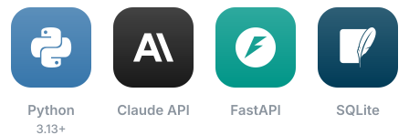
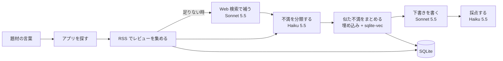

# app-scout

競合アプリのレビューから不満を集め、新しいアプリの企画書の下書きを作るエージェント



## ✨ 機能

| 部品 | できること |
| --- | --- |
| 収集 | App Store の RSS からレビューを集め、足りない分を Web 検索で補う |
| 分類 | Haiku 5.5 で、レビューを不満の種類と重さに分ける |
| まとめ | 手元の埋め込みと sqlite-vec で、似た不満をまとめる |
| 下書き | Sonnet 5.5 で、overview と roadmap の下書きを書く |
| 採点 | Haiku 5.5 で、下書きが不満に応えているかを採点する |

## 🗺️ 全体像



## 💻 実行環境

| 項目 | 内容 |
| --- | --- |
| 言語 | Python 3.13 以上 |
| 道具 | uv 0.13 以上 |
| API | FastAPI |
| データ | SQLite、sqlite-vec |
| モデル | Claude API（Sonnet 5.5、Haiku 5.5）、手元の埋め込みモデル |

[手順とコマンド](docs/development.md)

## 🚀 入れ方

```sh
brew install uv
uv sync
```

## 📚 文書

| 文書 | 内容 |
| --- | --- |
| [docs/overview.md](docs/overview.md) | 狙い、守ること、解決したい不満、最初のリリースの機能 |
| [docs/roadmap.md](docs/roadmap.md) | 作る順番と状態 |
| [docs/development.md](docs/development.md) | 動かし方とコマンド |
